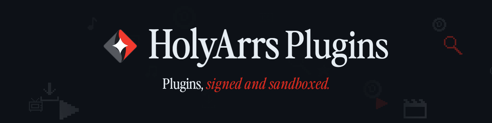

<p align="center">
  <picture>
    <source media="(prefers-color-scheme: light)" srcset="docs/assets/banner-plugins-light.gif">
    
  </picture>
</p>

<p align="center"><a href="https://holyarrs.com"><picture><source media="(prefers-color-scheme: dark)" srcset="https://raw.githubusercontent.com/HolyArrs/.github/main/profile/btn-site-dark.png"></picture></a>&nbsp;<a href="https://holyarrs.com/roadmap/"><picture><source media="(prefers-color-scheme: dark)" srcset="https://raw.githubusercontent.com/HolyArrs/.github/main/profile/btn-roadmap-dark.png"></picture></a>&nbsp;<a href="https://holyarrs.com/whats-new/"><picture><source media="(prefers-color-scheme: dark)" srcset="https://raw.githubusercontent.com/HolyArrs/.github/main/profile/btn-news-dark.png"></picture></a>&nbsp;<a href="https://community.holyarrs.com"><picture><source media="(prefers-color-scheme: dark)" srcset="https://raw.githubusercontent.com/HolyArrs/.github/main/profile/btn-community-dark.png"></picture></a></p>

<p align="center">
  <a href="LICENSE"></a>
</p>

<h3 align="center">Extras for HolyArrs, checked by us and walled off from your library.</h3>

<p align="center"><a href="https://github.com/HolyArrs/HolyArrs">HolyArrs</a> is one self-hosted app for finding, downloading and organising films, shows and music. Plugins add things it doesn't do on its own.</p>

<p align="center">
  <a href="#use">Use plugins</a> ·
  <a href="#plugins">The list</a> ·
  <a href="#runs">How it runs</a> ·
  <a href="#signing">Review</a> ·
  <a href="#make">Make one</a> ·
  <a href="#help">Help</a>
</p>

> [!NOTE]
> Plugins arrive with HolyArrs 1.3.0.

<a id="use"></a>
<a id="install"></a>
## 📦 Using plugins

You don't need any plugins. HolyArrs works fully without them.

1. Run HolyArrs 1.3.0 or newer on Linux, which includes the Docker image (amd64, arm64 or armv7). Windows and macOS installs can't run plugins.
2. Open **Plugins** in the HolyArrs menu. Only the owner sees it.
3. Read what the plugin does, which websites it calls, which folders it asks for and which HolyArrs permissions it needs, then press **Install**. Anything that can delete, change your media files, forward HolyArrs or act as a download client has a red warning.

Why you can trust them:

- We build every plugin ourselves from its public source code, after we've read that code.
- Your HolyArrs checks our signature before it installs anything, and checks every 6 hours for versions we've blocked and switches them off.
- A plugin can only reach the websites it lists, the folders you approve and the HolyArrs permissions you approve, from 80+ in 8 groups. It can't see your other files or the HolyArrs database.
- Some parts are closed to every plugin: the plugin system, accounts and sign-in, passwords and connection secrets, and server settings and controls. [The full list](https://docs.holyarrs.com/run/plugin-permissions/).

<details>
<summary><b>Questions people ask</b></summary>

- **How do I remove one?** Press Remove on the Plugins page. That deletes the plugin and its own data. Folders you approved for it are left alone.
- **What do I answer when it asks to approve websites, folders or permissions?** Approve only if the reason makes sense for what the plugin does. You can say no and remove it.
- **What happens when an update asks for more?** The new version waits for your OK, and the one you have keeps running.
- **A plugin wants more memory or CPU?** It starts at 512 MiB, 1 CPU, 256 processes and 1024 open files. An author can ask for more; you see it at install and can change it on the plugin's card.
- **A plugin asks for a code?** Plugins that act for a person (request bots, list sync) show a code. Enter it in My account → Linked plugins, and the plugin can then act for you, within your own permissions and limits.
- **The Plugins page says this system can't lock plugin files, or can't keep plugins to their websites?** Your system is missing the file lock or the network lock the sandbox needs. The card asks once, for all your plugins, whether they may run anyway. Choose Keep off unless you trust every plugin you install as much as HolyArrs itself. [What changes](docs/plugin-api.md#when-the-sandbox-is-weaker).
- **Will I know if a plugin gets blocked?** Yes. It stops, and the Plugins page shows it was turned off because it's on our blocklist.

</details>

<a id="plugins"></a>
## 🗂️ Plugins you can install

<!-- gallery:start -->
<a href="catalog/active/"><picture><source media="(max-width: 600px) and (prefers-color-scheme: light)" srcset="docs/assets/plugins-light-narrow.svg"><source media="(max-width: 600px)" srcset="docs/assets/plugins-dark-narrow.svg"><source media="(prefers-color-scheme: light)" srcset="docs/assets/plugins-light.svg"></picture></a>
<!-- gallery:end -->

<details>
<summary><sub>As a table</sub></summary>

<!-- plugins:start -->
<table>
<tr><th>Plugin</th><th>What it does</th><th>Made by</th><th>Version</th></tr>
<tr><td nowrap><b><a href="catalog/active/tailscale.json">&nbsp;Tailscale</a></b></td><td>Reach HolyArrs from anywhere through your own Tailscale network, without opening ports. Sign-in is still required for every visit.</td><td nowrap><a href="https://github.com/CoderLuii">&nbsp;CoderLuii</a></td><td nowrap><code>1.0.0</code></td></tr>
<tr><td nowrap><b><a href="plugins/language-packs/">&nbsp;Language Packs</a></b></td><td>HolyArrs in 43 more languages. Pick yours during setup or in My account.</td><td nowrap><a href="https://github.com/CoderLuii">&nbsp;CoderLuii</a></td><td nowrap><code>1.0.0</code></td></tr>
</table>
<!-- plugins:end -->

</details>

<sub>The version is the plugin's own; each plugin page in HolyArrs shows the HolyArrs version it needs (1.3.0 for Tailscale and Language Packs).</sub>

<a id="runs"></a>
## 🔌 How a plugin runs

<p align="center">
  <picture>
    <source media="(max-width: 600px) and (prefers-color-scheme: light)" srcset="docs/assets/plugin-runtime-light-narrow.svg">
    <source media="(max-width: 600px)" srcset="docs/assets/plugin-runtime-dark-narrow.svg">
    <source media="(prefers-color-scheme: light)" srcset="docs/assets/plugin-runtime-light.svg">
    
  </picture>
</p>

A plugin starts when you press Start and stays off if it stops or crashes. Saving its settings restarts it. It calls HolyArrs only through the permissions you approved, and every call goes in its activity log. The full rules are in [how plugins work](docs/how-plugins-work.md).

<a id="signing"></a>
<a id="review"></a>
## 🔏 How we review and sign

<p align="center">
  <picture>
    <source media="(max-width: 600px) and (prefers-color-scheme: light)" srcset="docs/assets/review-flow-light-narrow.svg">
    <source media="(max-width: 600px)" srcset="docs/assets/review-flow-dark-narrow.svg">
    <source media="(prefers-color-scheme: light)" srcset="docs/assets/review-flow-light.svg">
    
  </picture>
</p>

The signing key lives only in a separate job that never runs plugin code. How the build is locked down is in [how plugins work](docs/how-plugins-work.md#review).

<a id="make"></a>
## 🛠️ Make your own plugin

A plugin is one small Go program in your own public GitHub repo. To list it, fork this repo, add `catalog/active/<id>.json` and open one pull request.

The `plugins/` folder holds only the plugins we make ourselves. Community plugins stay in their authors' own repos and are listed in `catalog/` the same way ours are. Every plugin, ours included, goes through the same review and signing.

With a coding assistant? Paste this prompt into it:

```text
Read https://holyarrs.com/ai/plugin.md and help me make a HolyArrs plugin. My idea: ...
```

<p align="center"><a href="docs/making-a-plugin.md"></a>&nbsp;<a href="docs/plugin-api.md"></a></p>

> [!TIP]
> **Questions about plugins?** Ask us here.
>
> | | |
> |:---:|---|
> | <a href="https://community.holyarrs.com/c/help/6"></a> | Ask and share plugin ideas on the [HolyArrs Community](https://community.holyarrs.com/c/help/6) |
> | <a href="https://discord.com/invite/mthsvesKpC"></a> | Quick chat on [Discord](https://discord.com/invite/mthsvesKpC) |
> | <a href="https://reddit.com/r/HolyArrs"></a> | Follow along on [r/HolyArrs](https://reddit.com/r/HolyArrs) |

<a id="help"></a>
## 🆘 Help

- Questions: [Community Help](https://community.holyarrs.com/c/help/6). Ideas: [Feature ideas](https://community.holyarrs.com/c/feature-ideas/10).
- Plugin problems: [open a report](https://github.com/HolyArrs/HolyArrs-Plugins/issues/new?template=report-a-plugin.yml).
- Security problems: report them privately, as [SECURITY.md](.github/SECURITY.md) explains.
- HolyArrs itself: [the main repo](https://github.com/HolyArrs/HolyArrs/issues).
- Guide: [Plugins in HolyArrs](https://github.com/HolyArrs/HolyArrs/blob/main/docs/run/plugins.md).

<details>
<summary><b>What's in here</b></summary>

```
catalog/active/     one <id>.json per plugin you can install, ours and the community's,
                    plus language-packs.json (Language Packs)
catalog/inactive/   plugins that take no new installs
plugins/            the code of the plugins we make ourselves
docs/               the guides, the starter file and its rules
.github/            the workflows that check and publish plugins
```

</details>

## Licence

[AGPL-3.0](LICENSE), same as HolyArrs. Each plugin keeps its own licence.
